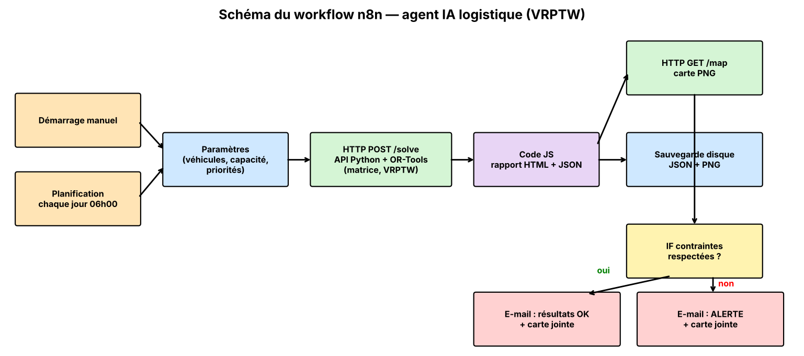

# Partie 1 — Compréhension du problème

## 1. Contexte logistique

L'entreprise **VPR Logistics** livre **20 clients** à partir d'un **dépôt central** situé en (25, 25). Elle dispose de **3 véhicules identiques** de **50 colis** chacun. Chaque client a une position (x, y), une **demande** en colis, un **temps de service** (déchargement) et parfois une **fenêtre horaire** de livraison. La demande totale est de **118 colis** pour une capacité de flotte de **150 colis** (taux de remplissage global : 79 %). L'entreprise cherche à **minimiser le temps/la distance parcourue** tout en servant tous les clients dans les délais.

## 2. Contraintes principales

| Contrainte | Description dans le problème |
|---|---|
| **Capacité** | Charge d'une tournée ≤ 50 colis. |
| **Fenêtres de temps** | 8 clients ont une fenêtre : 480–720 min (clients 1, 7, 11, 16) ou 780–1020 min (clients 4, 9, 13, 19). Le véhicule peut arriver avant et attendre, mais le service doit commencer avant la fin de la fenêtre. |
| **Priorités** | Niveau 1 (faible) à 3 (urgente) : les clients urgents doivent être servis plus tôt. |
| **Structure des tournées** | Chaque tournée commence et finit au dépôt ; chaque client est visité une seule fois. |
| **Horizon** | Journée de 1440 min (24 h) ; temps de service ajouté au temps de trajet. |

## 3. Pourquoi est-ce un Vehicle Routing Problem (VRP) ?

Il faut décider **à la fois** (i) quel véhicule dessert quel client (affectation) et (ii) dans quel **ordre** (séquencement), en partant d'un dépôt unique avec une flotte limitée. C'est la généralisation du voyageur de commerce (TSP) à plusieurs véhicules. Avec capacités, il s'agit d'un **CVRP** ; avec fenêtres horaires, d'un **VRPTW**, problème NP-difficile résolu ici par des méthodes d'optimisation (OR-Tools : solution initiale + recherche locale guidée).

# Partie 2 — Modélisation mathématique

**Ensembles** : N = {0, 1, …, 20} (0 = dépôt), C = {1, …, 20} (clients), K = {1, …, m} (véhicules, m = 3).

**Paramètres** : d_ij distance/temps de trajet (formule euclidienne), q_i demande, t_i temps de service, [a_i, b_i] fenêtre horaire, p_i priorité, w_p pondération de la priorité p, Q capacité, α intensité de l'effet priorité.

## 1. Variables

- x_ijk ∈ {0,1} : vaut 1 si le véhicule k se rend directement du noeud i au noeud j (en notant x_ij = Σ_k x_ijk lorsque l'on ne distingue pas les véhicules).
- s_i ≥ 0 : instant de début du service chez le client i.

## 2. Fonction objective

$$\min Z \;=\; \sum_{k\in K}\sum_{i\in N}\sum_{j\in N} d_{ij}\,x_{ijk} \;+\; \alpha \sum_{i\in C} w_{p_i}\,\max(0,\; s_i - a_i)$$

Le premier terme est la **distance totale** ; le second est un terme de **priorité** (un client urgent servi tard coûte plus cher). Avec α = 0, on retrouve la minimisation de distance pure.

## 3. Contraintes

a) **Chaque client visité une seule fois** : $\sum_{k}\sum_{j\in N, j\ne i} x_{ijk} = 1 \quad \forall i \in C$

b) **Chaque tournée commence et finit au dépôt**, avec conservation du flot :
$\sum_{j\in C} x_{0jk} = 1,\;\; \sum_{i\in C} x_{i0k} = 1 \quad \forall k$ ; $\sum_{i} x_{ihk} = \sum_{j} x_{hjk} \quad \forall h\in C,\forall k$

c) **Capacité** : $\sum_{i\in C} q_i \sum_{j\in N} x_{ijk} \le Q \quad \forall k$

d) **Fenêtres de temps** (elles éliminent aussi les sous-tours) :
$s_j \ge s_i + t_i + d_{ij} - M\,(1 - \sum_k x_{ijk}) \quad \forall i,j$ ; $\; a_i \le s_i \le b_i \quad \forall i \in C$

e) $x_{ijk}\in\{0,1\}$, $s_i \ge 0$.

# Partie 3 — Application IA

L'application est dans le dossier `vrp_agent/` :

| Fichier | Rôle |
|---|---|
| `data/clients.csv` | Données des tableaux (dépôt + 20 clients). |
| `vrp_solver.py` | Moteur : matrice euclidienne, modèle OR-Tools (capacité, fenêtres, priorités), contrôle indépendant des contraintes, carte. |
| `app.py` | Interface Streamlit : saisie du nombre de véhicules, capacité, pondérations de priorité ; affichage des résultats. |
| `api.py` | API Flask appelée par n8n (`POST /solve`). |
| `n8n_workflow.json` | Workflow n8n importable (Partie 6). |

**Algorithme** : OR-Tools Routing, solution initiale `PATH_CHEAPEST_ARC`, amélioration par *Guided Local Search*. Le temps de trajet est égal à la distance euclidienne (en minutes) ; le temps de service est ajouté à chaque arrêt. Les priorités sont traitées en **coût de retard pondéré** et comme **pénalité d'abandon** (un client urgent est le dernier à être abandonné si la capacité manque). La matrice complète 21 × 21 est générée automatiquement ; elle **coïncide avec l'extrait du Tableau 2** (écart < 0,02).

**Lancement** :

```
pip install -r requirements.txt
python vrp_solver.py --vehicles 3 --capacity 50 --weights 1,2,3   # ligne de commande
streamlit run app.py                                              # interface
python api.py                                                     # API pour n8n
```

# Partie 4 — Visualisation


Les carrés correspondent aux clients avec fenêtre horaire, les ronds aux clients sans fenêtre.

# Partie 5 — Analyse des résultats

Résultats de référence (3 véhicules × 50 colis, fenêtres actives, pondérations 1-2-3, intensité 0,01) :

| Véhicule | Tournée | Distance (min) | Charge | Attente totale (min) | Retour au dépôt (min) |
|---|---|---|---|---|---|
| V1 | 0 → 10 → 18 → 17 → 1 → 5 → 11 → 3 → 0 | 77,82 | 41/50 (82 %) | 404 | 556 |
| V2 | 0 → 7 → 16 → 4 → 13 → 0 | 40,43 | 28/50 (56 %) | 266 | 816 |
| V3 | 0 → 15 → 2 → 6 → 12 → 20 → 14 → 8 → 9 → 19 → 0 | 71,64 | 49/50 (98 %) | 661 | 812 |
| **Total** | | **189,88** | **118** | | |

Toutes les contraintes sont respectées : chaque client une fois, début/fin au dépôt, capacité, fenêtres horaires, tous les clients servis.

**1. Distance totale optimale trouvée.** **189,88 min** avec prise en compte des priorités. Si les priorités sont ignorées, la meilleure distance trouvée est **186,40 min** (valeur confirmée par une recherche de 30 s) : la prise en compte des priorités coûte donc seulement **3,5 min (+1,9 %)**. Sans fenêtres horaires ni priorités, on obtient **180,91 min**.

**2. Tournée la plus chargée.** **V3 : 49 colis sur 50 (98 %)**, aussi la plus longue en durée (812 min, dont 661 min d'attente). V2 est la moins chargée (28 colis, 56 %).

**3. Contrainte la plus influente.**

| Scénario | Distance (min) | Clients non servis |
|---|---|---|
| Référence (3 × 50, fenêtres, priorités) | 189,88 | — |
| Sans priorités | 186,40 | — |
| Sans fenêtres ni priorités | 180,91 | — |
| Capacité 40 colis | 206,07 (+8,5 %) | — |
| Capacité 35 colis (105 < 118) | 195,78 | 2 (clients 6 et 11) |
| 2 véhicules × 50 (100 < 118) | 166,61 | 2 (clients 6 et 17) |

- La **capacité** est la contrainte la plus *structurante* : dès que la capacité totale descend sous 118 colis, le problème devient infaisable et des clients sont abandonnés ; à 40 colis la distance augmente de 8,5 %. V3 est déjà à 98 %.
- Les **fenêtres horaires** pèsent peu sur la distance (environ +3 %), mais énormément sur le **temps** : les 8 clients à fenêtre 480–720 ou 780–1020 forcent les véhicules à attendre (jusqu'à 661 min cumulées) et allongent les tournées à plus de 800 min.
- Les **priorités** ont un effet faible sur la distance (+1,9 %) mais avancent nettement les clients de priorité 1 (début de service moyen de 630 min à 267 min). Le client de priorité 3 (client 9) est borné par sa fenêtre (780 min).

**4. Améliorations réalistes proposées.**

- **Décaler les départs** et regrouper les clients à fenêtre dans la même tournée pour réduire l'attente (le véhicule peut effectuer d'abord les clients sans fenêtre puis rentrer au dépôt, ce qui libère le chauffeur).
- **Rééquilibrer les charges** : V2 n'est chargé qu'à 56 % tandis que V3 est à 98 % ; un objectif d'équilibrage (min–max des durées) ou une réaffectation de 1 à 2 clients améliore la robustesse (aléas de trafic).
- **Marge de sécurité** sur la capacité (ex. 90 %) et **fenêtres souples avec pénalité** pour absorber les retards.
- **Temps de trajet réels** (trafic, API cartographique) à la place de la distance euclidienne, et **replanification dynamique** via n8n lorsqu'une commande urgente (priorité 3) arrive.

# Partie 6 — Conception d'une IA logistique avec n8n

## Schéma du flux



## Fonctionnement général

Le fichier `n8n_workflow.json` s'importe directement dans n8n (menu *Import from file*). Le flux orchestre les cinq étapes demandées, **sans intervention manuelle** une fois planifié :

1. **Récupération des données / paramètres** : un déclencheur (manuel ou planifié chaque jour à 6 h) alimente un noeud *Set* contenant le nombre de véhicules, la capacité, les pondérations de priorité et la durée de recherche ; les clients, coordonnées, demandes et fenêtres sont lus dans `data/clients.csv` côté Python.
2. **Calcul automatique de la matrice des distances** : fait par le script Python lors de l'appel (formule euclidienne à partir des coordonnées).
3. **Lancement du solveur** : un noeud *HTTP Request* appelle `POST /solve` de l'API Flask, qui exécute le code VRP (OR-Tools) développé précédemment.
4. **Analyse et visualisation** : un noeud *Code* construit un rapport HTML (distance totale, tournées par véhicule, charge, contrôle des contraintes) et un second appel `GET /map` télécharge l'image de la carte des tournées.
5. **Export / notification** : le JSON et le PNG sont stockés sur disque (*Read/Write Files*), puis un noeud *IF* envoie un **e-mail « résultats OK »** ou un **e-mail « ALERTE »** (si une contrainte est violée) avec la carte en pièce jointe.

**Mise en route** : démarrer `python api.py`, importer le workflow, adapter `api_url` (si n8n tourne dans Docker : `http://host.docker.internal:5000`), choisir les identifiants SMTP dans les deux noeuds e-mail, puis exécuter.
